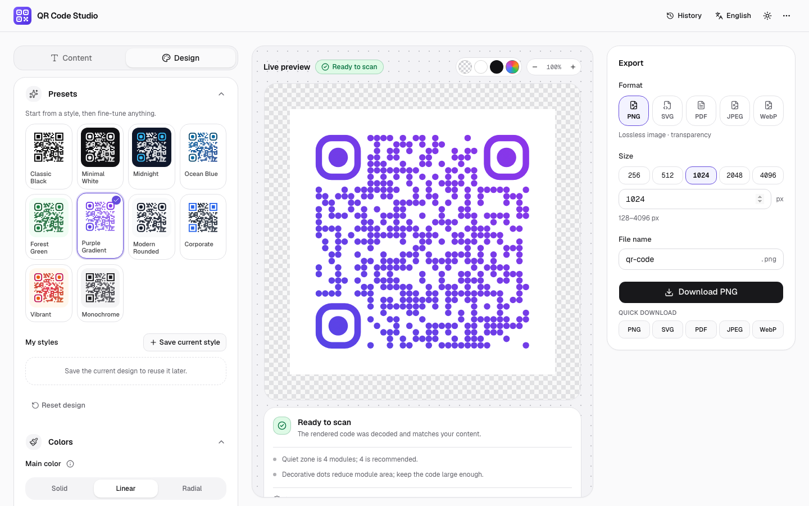
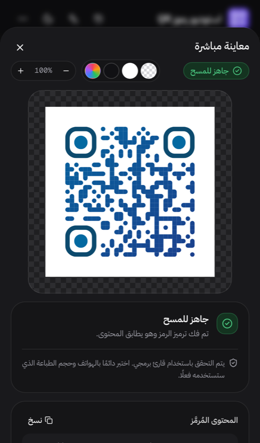

# QR Code Studio

**Design, validate and export professional QR codes, entirely in your browser.**

QR Code Studio is a free, open-source QR code generator and designer. You enter content, style the code, check that it really scans, and download it as PNG, SVG, PDF, JPEG or WebP. No account, no tracking, no redirect service: static codes contain your content directly.

**Live website:** https://salar-dev.github.io/QR-Code-Studio
**Repository:** https://github.com/salar-dev/qr-code-studio



<p align="center">
  
</p>

## Contents

- [Features](#features)
- [Technology stack](#technology-stack)
- [Getting started](#getting-started)
- [Usage](#usage)
- [Deployment](#deployment)
- [Project structure](#project-structure)
- [How it works](#how-it-works)
- [File uploads (optional, self-hosted)](#file-uploads-optional-self-hosted)
- [Privacy](#privacy)
- [Localization](#localization)
- [Testing](#testing)
- [Known limitations](#known-limitations)
- [Developer](#developer)

## Features

**12 content types**, each producing the payload format its standard or app expects:

| Type | Encoded as |
| --- | --- |
| Website | Normalized `http(s)` URL (`https://` added when missing, IDN domains converted to punycode, unsafe schemes rejected) |
| Text | UTF-8 text in any language |
| File | Link to a hosted file |
| Email | `mailto:` (RFC 6068) with subject and body |
| Phone | `tel:+…` (Arabic-Indic digits accepted) |
| SMS | `SMSTO:number:message` (most compatible) or `sms:` (RFC 5724) |
| WhatsApp | `https://wa.me/<number>?text=…` |
| Wi-Fi | `WIFI:T:WPA;S:…;P:…;H:true;;` with proper escaping |
| Contact | vCard 3.0 |
| Location | `geo:` (RFC 5870), Google Maps or Apple Maps link |
| Calendar event | iCalendar `VEVENT` (times stored in UTC, all-day events supported) |
| Social profile | Instagram, Facebook, TikTok, YouTube, X, LinkedIn or Telegram profile URL |

**Design**

- Solid, linear and radial gradient colors with up to five stops and an adjustable angle.
- Separate colors for dots, corner frames and corner centers.
- Color picker with hex input, palette, recently used colors and the browser eyedropper (where supported).
- Solid, transparent or gradient backgrounds with rounded corners. A white code on a transparent background works and exports correctly.
- 6 dot styles, 7 corner-frame styles and 7 corner-center styles with visual previews, plus a circular code shape.
- Logo upload (PNG, JPEG, WebP, SVG) with size, padding, an optional backing plate and clearing of the modules behind it.
- Adjustable quiet zone (margin) and all four error-correction levels with explanations.
- 10 built-in presets. Save your own styles, then rename, duplicate or delete them.

**Live preview and scan verification**

- Updates as you type, without flicker. Zoom in and out, and preview on a checkerboard, light, dark or custom backdrop.
- Every render is decoded with ZXing and compared with your content. Light-on-dark codes are retried as inverted codes.
- Clear status ("Ready to scan", "Low contrast warning", "Potentially difficult to scan", "Invalid content", "Validation failed") plus checks for contrast, quiet zone, logo size versus error correction, decorative corners, code density and pixel size.

**Export**

- **PNG** and **WebP** with a real alpha channel; **SVG** as true vector output; **PDF** as vector, sized to the code or placed on an A4 or US Letter page; **JPEG** with a fill color of your choice.
- Sizes from 128 to 4096 px, custom file names and JPEG/WebP quality.

**Everything else**

- English and Arabic, with a correct right-to-left layout.
- Light, dark and system themes.
- Designed for phones, tablets and desktops.
- Your last session is restored, downloads are kept in a local history, and you can copy the encoded content or reset everything.
- Private fields (Wi-Fi passwords, contact details) are never stored unless you opt in.

## Technology stack

| Area | Tools |
| --- | --- |
| Framework | [Next.js](https://nextjs.org) 16 (App Router, Turbopack), [React](https://react.dev) 19, [TypeScript](https://www.typescriptlang.org) 5 |
| UI | [Tailwind CSS](https://tailwindcss.com) 4, [shadcn/ui](https://ui.shadcn.com) on [Radix UI](https://www.radix-ui.com), [Lucide](https://lucide.dev) icons, [Motion](https://motion.dev), [Sonner](https://sonner.emilkowal.ski), [react-colorful](https://github.com/omgovich/react-colorful) |
| QR rendering | [qr-code-styling](https://github.com/kozakdenys/qr-code-styling), [qrcode-generator](https://github.com/kazuhikoarase/qrcode-generator) |
| QR decoding | [@zxing/library](https://github.com/zxing-js/library) |
| PDF export | [jsPDF](https://github.com/parallax/jsPDF) + [svg2pdf.js](https://github.com/yWorks/svg2pdf.js) |
| Optional uploads | [Supabase Storage](https://supabase.com/docs/guides/storage) (server only) |
| Testing | [Vitest](https://vitest.dev), [Playwright](https://playwright.dev), [axe-core](https://github.com/dequelabs/axe-core-npm) |
| Hosting | [GitHub Pages](https://pages.github.com) (static) or any Node.js host |

## Getting started

**Requirements:** Node.js 20.9 or newer (22 recommended, see `.nvmrc`) and npm.

```bash
git clone https://github.com/salar-dev/qr-code-studio.git
cd qr-code-studio
npm install
npm run dev
```

Open http://localhost:3000. You are redirected to `/en` or `/ar` based on your saved choice or browser language.

### Scripts

| Script | What it does |
| --- | --- |
| `npm run dev` | Development server |
| `npm run build` / `npm run start` | Production build and Node.js server (includes the optional upload API) |
| `npm run build:pages` | Static export for GitHub Pages, written to `out/` |
| `npm run preview:pages` | Serves `out/` like GitHub Pages at http://localhost:4173/qr-code-studio/ |
| `npm run typecheck` | TypeScript type check |
| `npm run lint` | ESLint |
| `npm test` | Unit tests (Vitest) |
| `npm run test:e2e` | End-to-end tests of the server build (run `npm run build` first) |
| `npm run test:e2e:pages` | End-to-end tests of the static GitHub Pages build (builds it automatically) |
| `npm run check` | Type check, lint and unit tests |

The end-to-end tests need Playwright's browsers once: `npx playwright install chromium webkit`.

## Usage

1. **Choose what the code should do** in the *Content* tab (website, Wi-Fi, contact, event…) and fill in the form. Fields are validated as you go.
2. **Style it** in the *Design* tab: start from a preset, then adjust colors, gradients, shapes, background, logo, margin and error correction.
3. **Check the status** under the preview. "Ready to scan" means the rendered code was decoded and matched your content. Choose the preview backdrop that matches where the code will be placed (important for transparent codes).
4. **Export** from the *Export* panel: pick a format and size, name the file and download. *Quick download* exports another format in one click.
5. Find previous downloads under **History**. Manage local storage and privacy options under **⋯ → Privacy & storage**.

## Deployment

The same codebase supports two targets.

### GitHub Pages (static, recommended)

The repository includes a workflow, `.github/workflows/deploy-pages.yml`, that runs checks, builds the static export and publishes it on every push to `main`. The site is served from `https://salar-dev.github.io/qr-code-studio/`.

The Pages build:

- Uses `output: "export"` with the `/qr-code-studio` base path and trailing slashes, so every page is a plain `index.html`.
- Replaces the server proxy with a root `index.html` that sends visitors to their saved or browser language.
- Publishes `404.html`, `robots.txt`, `sitemap.xml`, `manifest.webmanifest` and a social preview image (`og.png`).
- Leaves out server-only code (files named `*.server.ts`, such as the upload API). The File content type then works with links to hosted files, and the upload option explains that uploads aren't available on this deployment.

To check a Pages build locally:

```bash
npm run build:pages
npm run preview:pages
```

If you use a custom domain or a different repository name, the workflow picks up the correct base path and URL automatically from GitHub Pages. For a local build, set `PAGES_BASE_PATH` and `NEXT_PUBLIC_SITE_URL`.

### Node.js server (for file uploads)

```bash
npm run build
npm run start
```

This target adds a locale-detecting proxy, security headers and the optional upload API. It runs on any platform that supports Next.js.

### Environment variables

See `.env.example`. All variables are optional.

| Variable | Purpose |
| --- | --- |
| `NEXT_PUBLIC_SITE_URL` | Public URL used for canonical links, social previews and the sitemap. Set automatically by the Pages workflow. |
| `PAGES_BASE_PATH` | Base path for the static export (default `/qr-code-studio`). Set automatically by the Pages workflow. |
| `SUPABASE_URL`, `SUPABASE_SERVICE_ROLE_KEY` (or `SUPABASE_SECRET_KEY`), `SUPABASE_STORAGE_BUCKET` | Enable file uploads (server target only) |
| `UPLOAD_MAX_MB` | Upload size limit in MB (default 10, maximum 50) |

## Project structure

```
src/
  app/
    (entry)/             root "/" page: language redirect for static hosting
    [locale]/            layout (html lang/dir, theme script, metadata) and the studio page
    api/upload/          upload API (route.server.ts, server build only)
    og.png/              social preview image, rendered at build time
    global-not-found.tsx 404 page
  proxy.server.ts        locale redirect for the server build
  i18n/                  locales, English/Arabic dictionaries, provider
  lib/
    qr/content/          content model, validation, payload encoders
    qr/design/           design model, defaults, presets, color tools, logo intake
    qr/render/           encoding matrix, renderer, rasterizer, render state
    qr/export/           PNG, JPEG, WebP, SVG and PDF export
    qr/validation/       contrast, design analysis, ZXing decoding
    store/               editor state, saved styles, history
    persistence/         safe localStorage access and validation of stored data
    storage/, upload/    storage provider interface, Supabase provider, upload policy
  components/
    studio/              editor: content forms, design panel, preview, export, mobile dock
    app/                 header, footer, menus, history, privacy settings
    ui/                  shadcn/ui primitives
scripts/preview-pages.mjs  local GitHub Pages–style static server
tests/unit/              Vitest tests
tests/e2e/               Playwright tests (server build)
tests/e2e-pages/         Playwright tests (static GitHub Pages build)
.github/workflows/       CI and GitHub Pages deployment
```

## How it works

- **Content and design are separate.** Content produces a payload string; the design only describes appearance. Any content works with any design, and presets or saved styles never change your content.
- **One SVG is the source of truth.** The code is rendered as an SVG at the exact export size. The preview shows that SVG, raster exports and the scan check are drawn from it, and the PDF is converted from it as vectors, so downloads always match the preview.
- **Correct UTF-8.** The encoder inside qr-code-styling keeps only one byte per character, which would silently corrupt Arabic, Chinese or emoji text. Payloads are converted to UTF-8 bytes first, and tests decode the result to prove it round-trips exactly.
- **Real transparency.** A transparent background produces no background shape at all, so exported PNG, WebP and SVG files keep a true alpha channel.
- **Fast loading.** The QR renderer, the decoder and the PDF libraries load only when first needed. The design panel is split into its own chunk and fetched while the browser is idle. Rendering is debounced and decoding runs when the main thread is idle.
- **Resilient.** Out-of-date renders are discarded, a failed library load is retried automatically, and corrupted saved data is rebuilt from defaults.

## File uploads (optional, self-hosted)

A QR code can't contain a file, so the File type encodes a **link** to a hosted file. Pasting a link always works. Uploading requires the Node.js server target and storage credentials; without them, the app says uploads aren't available instead of faking them.

**Enable Supabase Storage**

1. Create a **public** Storage bucket (for example `qr-files`). As extra protection, set the bucket's size limit and allowed MIME types to match the policy below.
2. Copy `.env.example` to `.env.local` and set `SUPABASE_URL`, `SUPABASE_SERVICE_ROLE_KEY` and `SUPABASE_STORAGE_BUCKET`.
3. Run the server target (`npm run build && npm run start`). `GET /api/upload` now reports `{"enabled": true}`.

Credentials are only read in server code and never reach the browser. To use another provider (S3, R2, GCS…), implement `StorageProvider` in `src/lib/storage/types.ts` and return it from `getStorageProvider()`.

**Security**

- File types are verified from the file content (magic bytes), not the name or declared type.
- Allowed types: PDF, PNG, JPEG, GIF, WebP, MP3, MP4, TXT/CSV (UTF-8) and DOCX/XLSX/PPTX. HTML, SVG, scripts, executables and archives are rejected.
- Size limits are enforced before and after the body is read, and cross-site browser requests are rejected.
- Each client is limited to 10 uploads per 10 minutes. The limiter keeps its state in memory per server instance, so use a shared store such as Redis for multi-instance deployments.
- Files get random names, and error responses never expose internal details.

**Access and retention:** uploaded files are **public**. Anyone with the code or the URL can download them. The app doesn't delete uploads, so if you need a retention period, schedule a cleanup job through the Supabase Storage API and tell your users the rules.

## Privacy

- Without an upload, nothing leaves your browser. There are no analytics, no tracking and no redirect service.
- Data is stored only in your browser's `localStorage`: the last session, saved styles, the last 12 downloads, recent colors and preferences.
- Wi-Fi passwords and contact details are removed before saving unless you enable *Also remember private fields*.
- The language choice is kept in a `NEXT_LOCALE` cookie scoped to the site.
- You can turn off session restore or delete all saved data under **⋯ → Privacy & storage**.

## Localization

- Dictionaries live in `src/i18n/messages/`. The Arabic dictionary is type-checked against the English one, so a missing key fails the build.
- To add a language: add a dictionary, then register it in `src/i18n/config.ts` and `src/i18n/dictionaries.ts`.
- Pages are rendered with the right `lang` and `dir` from the start (no flash of the wrong direction).
- Technical values (URLs, phone numbers, coordinates, sizes, payloads) always stay left-to-right.

## Testing

| Suite | Coverage |
| --- | --- |
| Unit (92 tests) | Payload encoders and validation, Wi-Fi, vCard and iCalendar formatting, ZXing decode round-trips (including Arabic, CJK, emoji and inverted codes), renderer output (transparency, gradients, corner colors), contrast and scannability analysis, stored-data validation, upload policy, handler and rate limiter |
| End-to-end, server build (32 tests) | Every export format checked at the byte level and decoded back to its content; transparent and white-code exports; gradients and logos; forms and validation; Arabic RTL; language switching; session restore and privacy; theme; saved styles; history; 404 page; SEO metadata; upload API; footer; mobile layout and touch targets; axe-core accessibility audit in English and Arabic, light and dark. Runs in Chromium and WebKit. |
| End-to-end, GitHub Pages build (9 tests) | Root language redirect, assets under the base path, rendering, verification and export, uploads reported as unavailable without server calls, language cookie scope, 404 page, SEO files and social image, footer, mobile layout |

The CI workflow (`.github/workflows/ci.yml`) runs all three suites on every pull request.

## Known limitations

- **The scan check is not a guarantee.** It decodes a perfect digital image. Test printed codes with real phones at their final size and lighting.
- **Uploads need a server.** On GitHub Pages, the File type works with links only.
- **WebP export depends on the browser.** Safari can't encode WebP, so the option is disabled there rather than producing a mislabeled file.
- **SVG logos are converted to images** for security, so logos are not vectors inside SVG and PDF exports.
- **Decorative styles scan less reliably.** The circular shape, dot or classy corner frames and light-on-dark (inverted) codes may not work with some scanners. The app warns about them.
- **Security headers only apply to the Node.js target.** GitHub Pages can't send custom HTTP headers.

## Developer

**Wasalat Developer**
GitHub: [@salar-dev](https://github.com/salar-dev)

Issues and suggestions are welcome at [github.com/salar-dev/qr-code-studio/issues](https://github.com/salar-dev/qr-code-studio/issues).

<sub>QR Code is a registered trademark of DENSO WAVE INCORPORATED.</sub>
